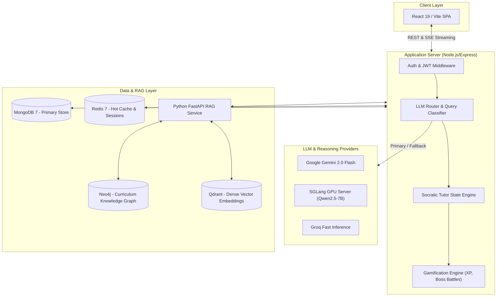

# iMentor: Adaptive Socratic AI Tutoring & Intelligent LLM Routing Platform

[](https://react.dev/)
[](https://nodejs.org/)
[](https://fastapi.tiangolo.com/)
[](https://www.mongodb.com/)
[](https://ai.google.dev/)
[](LICENSE)

> **Academic & Portfolio Attribution:**  
> This project was developed as part of an **AI Engineering & Research Internship at the National Institute of Technology (NIT) Andhra Pradesh (AI Lab)**.  
> It showcases a full-stack, pedagogical AI tutoring environment featuring Socratic guided dialogues, hybrid GraphRAG retrieval, adaptive Bloom's taxonomy assessment, and high-performance LLM routing with automated fallback cascades.

---

## 🌟 Key Features

### 1. 🎓 Socratic Pedagogical Engine
- **Guided Dialogue Machine:** Moves beyond simple question-and-answer by structuring learning through a 5-stage finite state machine:
  $$\text{PROBE} \longrightarrow \text{SCAFFOLD} \longrightarrow \text{CHALLENGE} \longrightarrow \text{REFLECT} \longrightarrow \text{ASSESS}$$
- **Bloom’s Taxonomy Tracking:** Evaluates student comprehension from *Remembering* and *Understanding* up to *Evaluating* and *Creating*.
- **Tree of Thoughts (ToT) & Chain of Thought (CoT):** Deep pedagogical reasoning for complex STEM problem decomposition.

### 2. ⚡ Intelligent LLM Routing & Fallback Cascade
- **Intent Classifier:** Detects query intention (direct answer, socratic inquiry, code generation, deep literature research).
- **Automated Fallback Chain:** Dispatches queries across tiers (Local SGLang GPU inference $\to$ Google Gemini 2.0 Flash API $\to$ Groq $\to$ Claude) with hot-swap configuration and zero-downtime streaming.
- **Server-Sent Events (SSE):** Token-by-token low-latency streaming to the frontend.

### 3. 🧠 Hybrid Knowledge Retrieval (GraphRAG + Vector Search)
- **Vector Retrieval:** Qdrant similarity search over chunked syllabus course documents and textbooks.
- **Knowledge Graph:** Neo4j stores curricular prerequisite relationships (`RELATES_TO`, `PREREQUISITE_OF`) for structured concept exploration.
- **Subtopic Notes (STN):** Automated synthesis of structured revision sheets and interactive concept maps.

### 4. 🎮 Gamification & Adaptive Mastery
- **Skill Tree Maps:** Visual DAG maps tracking student mastery node-by-node.
- **Dynamic Boss Battles:** AI-generated timed assessment challenges triggered upon completing concept clusters.
- **Bounties & XP:** Open community and algorithmic challenges awarding XP, streaks, and achievement badges.

---

## 🏗️ System Architecture



---

## 📂 Project Directory Structure

```text
iMentor-Main/
├── frontend/                  # React 19 + Vite frontend
│   ├── src/components/        # Socratic chat, skill tree, gamification UI
│   ├── src/pages/             # TutorMode, CourseExplorer, AdminDashboard
│   └── vercel.json            # 1-click Vercel SPA deployment configuration
├── server/                    # Node.js Express API backend
│   ├── config/                # Routing config, DB connections, Redis client
│   ├── routes/                # Chat, tutor, auth, analytics, courses
│   ├── services/              # LLM router, Socratic engine, Gemini/SGLang dispatchers
│   ├── models/                # Mongoose schemas (User, Gamification, Session)
│   └── .env.example           # Environment template
├── lecture_generator/         # Automated course bootstrap and lecture generation
├── docker-compose.yml         # Full local lab infrastructure (MongoDB, Redis, Neo4j, Qdrant)
└── ARCHITECTURE.md            # In-depth architectural specifications
```

---

## 🚀 Quick Start Guide

### Prerequisites
- Node.js $\ge$ 20.0.0
- npm $\ge$ 10.0.0
- MongoDB (local or free [MongoDB Atlas](https://www.mongodb.com/cloud/atlas))
- Google Gemini API Key ([Google AI Studio](https://aistudio.google.com/))

### 1. Clone & Set Up Environment
```bash
git clone https://github.com/<your-username>/imentor-ai.git
cd imentor-ai
```

### 2. Backend Setup
```bash
cd server
cp .env.example .env
```
Open `server/.env` and update the core credentials:
```env
PORT=5001
MONGO_URI=mongodb+srv://<username>:<password>@cluster.mongodb.net/imentor
JWT_SECRET=your_custom_secure_jwt_secret_32_chars
GEMINI_API_KEY=your_gemini_api_key_here
SGLANG_ENABLED=false
```

Install dependencies and start the backend:
```bash
npm install
npm run dev
```
The backend will be live at `http://localhost:5001`.

### 3. Frontend Setup
In a new terminal:
```bash
cd frontend
npm install
npm run dev
```
Open your browser at `http://localhost:3005` (or Vite's assigned port).

---

## 🌐 Cloud Deployment Guide

### Deploying the Frontend (Vercel)
1. Push this repository to your personal GitHub account.
2. Sign in to [Vercel](https://vercel.com/) and click **Add New Project**.
3. Select your repository.
4. Set **Root Directory** to `frontend`.
5. Set the Environment Variable:
   - `VITE_API_BASE_URL`: `https://your-backend-service.onrender.com/api`
6. Click **Deploy**.

### Deploying the Backend (Render / Railway)
1. On [Render](https://render.com/), create a new **Web Service** connected to your repository.
2. Set **Root Directory** to `server`.
3. Set **Build Command**: `npm install`
4. Set **Start Command**: `npm start`
5. Configure Environment Variables:
   - `NODE_ENV`: `production`
   - `PORT`: `5001`
   - `MONGO_URI`: Your MongoDB Atlas connection string
   - `JWT_SECRET`: Random 32-character string
   - `GEMINI_API_KEY`: Your Google Gemini API key
   - `SGLANG_ENABLED`: `false`
   - `FRONTEND_URL`: `https://your-frontend.vercel.app`
6. Click **Create Web Service**.

---

## 🛡️ License & Attribution

This project is released under the [MIT License](LICENSE).  
Original research, domain design, and architectural guidance originated from the **AI Research Lab at National Institute of Technology (NIT) Andhra Pradesh**.
